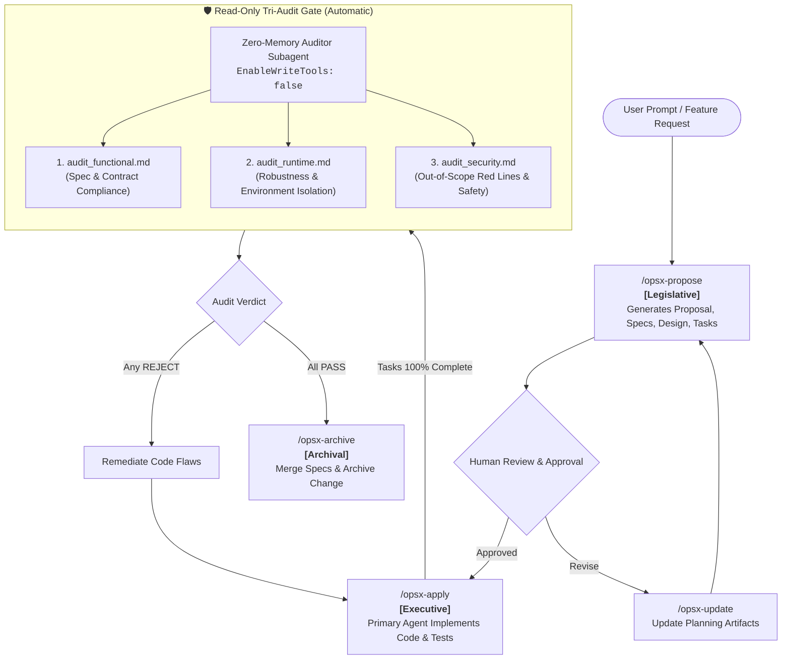

# OpenSpec-Guard 🛡️

> **Spec-Driven & Adversarial Read-Only Audited Development for AI Agents**  
> *Legislative Specification $\rightarrow$ Executive Implementation $\rightarrow$ Judicial Tri-Audit $\rightarrow$ Gated Archival*

[](LICENSE)
[](https://github.com/Fission-AI/OpenSpec)
[]()

---

## 💡 Why OpenSpec-Guard?

Most AI coding frameworks suffer from **"The Monolithic Dilemma"**:
The same AI agent that interprets your prompt also writes the code, tests its own logic, and convinces itself that everything works. When requirements shift or bugs occur, the agent often stealthily amends documentation or ignores edge cases to self-endorse.

**OpenSpec-Guard solves this by enforcing Separation of Powers:**
1. **Legislative (Specification)**: OpenSpec contracts (`proposal.md`, `specs/`, `design.md`, `tasks.md`) lock down the ground truth and strict boundary red lines.
2. **Executive (Implementation)**: The primary coding agent implements the tasks strictly per specification.
3. **Judicial (Read-Only Tri-Audit Gate)**: A zero-memory, physically write-disabled (`EnableWriteTools: false`) auditor independently audits the changes across 3 distinct dimensions.
4. **Archival (Gated Sync)**: Code is only allowed to merge into main specs when all 3 audit dimensions return a clean **PASS**.

---

## 🏛️ System Architecture



---

## 🔍 The 3 Independent Audit Dimensions

Audit reports are never lumped into a single bloated file. They are preserved as first-class change artifacts under `openspec/changes/<change-name>/audits/`:

| Dimension Report | Verification Target | Threat / Flaw Detected |
| :--- | :--- | :--- |
| **`audit_functional.md`** | `spec.md` & `tasks.md` | Incomplete feature requirements, untested boundary branches, schema divergence. |
| **`audit_runtime.md`** | `design.md` & `.venv` rules | Resource leaks, broad `except:`, unhandled exceptions, environment violation. |
| **`audit_security.md`** | `proposal.md` (`Out-of-Scope`) | Scope creep, unauthorized modifications, hardcoded secrets, injection vectors. |

---

## 🚀 Quick Start

### 1. Prerequisites
Ensure you have Node.js (>= 18) installed:
```bash
npm install -g @fission-ai/openspec@latest
```

### 2. Inject into Any Project

Clone this repository and run the setup script pointing to your project:

**Windows (PowerShell):**
```powershell
git clone https://github.com/houhoudehenduohhh/OpenSpec-Guard.git
cd OpenSpec-Guard
.\scripts\install.ps1 -TargetDir "C:\path\to\your\project"
```

**Linux / macOS (Bash):**
```bash
git clone https://github.com/houhoudehenduohhh/OpenSpec-Guard.git
cd OpenSpec-Guard
chmod +x ./scripts/install.sh
./scripts/install.sh /path/to/your/project
```

---

## ⚡ Workflow Commands (Slash Commands)

Open your agent (Antigravity, Claude Code, Cursor, Windsurf, etc.) and use the slash commands:

| Command | Action | Description |
| :--- | :--- | :--- |
| **`/opsx-propose "<idea>"`** | Draft Specs | Creates `proposal.md`, `specs/`, `design.md`, and `tasks.md`. **Zero code written.** |
| **`/opsx-apply`** | Execute & Audit | Implements tasks. **Automatically invokes the Read-Only Tri-Audit Gate upon 100% completion.** |
| **`/opsx-audit`** | Standalone Audit | Runs the independent 3-dimensional audit on demand. |
| **`/opsx-update`** | Revise Plan | Synchronizes changes across all 4 planning documents if human feedback requires changes. |
| **`/opsx-archive`** | Gated Merge | Verifies that all 3 audit reports are **PASS**, merges delta specs into main specs, and archives the change. |

---

## 🛡️ Why Read-Only Auditing is Mandatory

When an LLM is given tools to both edit code and verify code:
- If a test fails, the LLM will often "fix" the test rather than the code.
- If a requirement is hard, the LLM may silently tone down the requirement.

**OpenSpec-Guard enforces a hard constraint:**
The `spec-auditor` subagent is spawned with:
```json
{
  "Name": "spec-auditor",
  "EnableWriteTools": false,
  "EnableSubagentTools": false
}
```
Because write tools are physically absent from the subagent's toolset, **it is mathematically impossible for the auditor to alter code to cover up bugs**. It can only report objective, verifiable facts.

---

## 📄 License

This project is licensed under the [MIT License](LICENSE).  
Built upon the foundational specification workflow created by [Fission-AI/OpenSpec](https://github.com/Fission-AI/OpenSpec).
